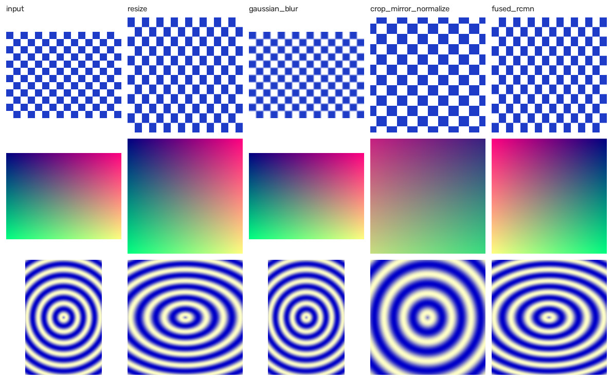

# hipAugment

hipAugment is a batched GPU image preprocessing library in C++ and HIP, built to the design of AMD's ROCm Performance Primitives (RPP). It has three operations, one fused kernel, a CLI, thin Python bindings, and a benchmark and profiling harness for the AMD Instinct MI300X.

| Op | Input | Output | What it does |
| --- | --- | --- | --- |
| `resize` | u8 NHWC | u8 NHWC | Bilinear resize of each image's ROI into the output size |
| `gaussian_blur` | u8 NHWC | u8 NHWC | 3x3 or 5x5 blur inside the ROI, edges clamped to the ROI |
| `crop_mirror_normalize` | u8 NHWC | f32 NCHW | Crop the ROI, flip x per image, `(x - mean) / std` |
| `fused_rcmn` | u8 NHWC | f32 NCHW | Crop, resize, mirror, normalize and layout change in one kernel |

Every op runs on a batch of N three-channel images of mixed sizes, each with its own region of interest (ROI), and writes into buffers the caller allocated.



The float outputs are mapped back to 0..255 for display. The grid above was produced by the CPU reference backend; `docs/make_grid.py` regenerates it with `--backend hip`.

## Results

**Not measured yet.** No number in this section comes from a GPU. The kernels compile with `hipcc` for the MI300X (`gfx942`) and pass the full GPU test suite on a CPU emulation of the HIP runtime (see [Tests](#tests)), but they have not run on an MI300X. The steps in [Running on the MI300X](#running-on-the-mi300x) produce everything below.

| What | Where it will appear |
| --- | --- |
| Median time, images per second and bandwidth for every op and batch size | `docs/results.csv`, table here |
| `fused_rcmn` speedup over `resize` + `crop_mirror_normalize` | `docs/results.csv` (`hip_fused` vs `hip_separate`), `docs/profile.md` |
| Throughput against the CPU reference, OpenCV and torchvision | `docs/throughput.png` |
| Achieved bandwidth per kernel as a share of MI300X peak | `docs/bandwidth.png` |
| rocprofv3 kernel time and bandwidth for every kernel | `docs/profile.md` |

What has been checked without a GPU, through the Python bindings on the emulation build:

| Check | Largest difference |
| --- | --- |
| `resize` vs OpenCV `INTER_LINEAR` | 0 (u8) |
| `gaussian_blur` 5x5 vs OpenCV `GaussianBlur`, replicated border | 1 (u8) |
| `fused_rcmn` vs OpenCV resize, flip, normalize | 0.0088, half of one u8 step (0.0175) |

## Build

Linux or WSL2. The CPU-only build needs a C++17 compiler and CMake 3.21 or newer. The HIP build needs ROCm.

```bash
scripts/build.sh && scripts/test.sh        # HIP backend if ROCm is installed, otherwise CPU only
HIPAUG_HIP=OFF scripts/build.sh            # force the CPU-only build
HIPAUG_PYTHON=ON scripts/build.sh          # also build the Python module
```

| CMake option | Default | Meaning |
| --- | --- | --- |
| `HIPAUG_BUILD_HIP` | ON | Build the HIP backend |
| `HIPAUG_BUILD_PYTHON` | OFF | Build the pybind11 module |
| `HIPAUG_HIP_EMULATION` | OFF | Test only: run the HIP kernels on a CPU emulation of the HIP runtime |

On a machine with ROCm but no GPU, CMake cannot detect the target architecture, so pass it: `scripts/build.sh -DCMAKE_HIP_ARCHITECTURES=gfx942`.

## Usage

### C++

```cpp
#include "hipaug/hipaug.hpp"
using namespace hipaug;

// src: N images padded to h_max x w_max, on the device. roi and mirror: one entry per image.
TensorDesc in  = make_desc(n, h_max, w_max, Layout::NHWC, DType::U8);
TensorDesc out = make_desc(n, 224, 224, Layout::NCHW, DType::F32);
const float mean[3] = {123.675f, 116.28f, 103.53f}, std[3] = {58.395f, 57.12f, 57.375f};

Status st = fused_rcmn(in, src, roi, mirror, mean, std, out, dst, stream);
if (st != Status::Ok) { /* InvalidArg or HipError; nothing was thrown */ }
```

The CPU reference has the same functions in `hipaug::cpu`, on host pointers and without the stream.

### CLI

```bash
hipaug run --op fused_rcmn --batch 16 --size 224x224 input_dir output_dir
hipaug run --op gaussian_blur --ksize 5 --sigma 2.0 --backend cpu input_dir output_dir
hipaug bench            # whole benchmark suite, writes results.csv
hipaug --help
```

### Python

```python
import hipaugment
x = hipaugment.fused_rcmn(batch, roi, (224, 224), mirror)   # GPU uint8 NHWC in, GPU float32 NCHW out
```

`python/dataloader_demo.py` pads mixed-size images in a `DataLoader` collate function and runs `fused_rcmn` on the GPU. Run it with `PYTHONPATH=python python3 python/dataloader_demo.py`.

## Design notes

**Batch storage.** Every image is padded to the largest size in the batch, with one ROI per image, as RPP does. One kernel launch covers the whole batch and indexing is one formula: `n * stride_n + y * stride_h + x * stride_w + c * stride_c`. Rejected: a packed buffer with offsets (harder indexing) and one launch per image (launch overhead).

**Thread mapping.** One thread per output pixel, grid z is the image index, and threads outside the ROI exit early. Rejected: one block per image, which balances badly when sizes are mixed.

**Block size.** 256 threads (16x16), four full 64-thread wavefronts. Sizes picked for a 32-thread warp leave lanes empty on AMD hardware.

**Bilinear convention.** Pixel centres: `src = (dst + 0.5) * scale - 0.5`, clamped to the ROI edge, rounded to nearest. This matches OpenCV `INTER_LINEAR` and torchvision, so the baselines compare like with like. Rejected: `align_corners=True`.

**Blur.** A single 2D pass. The default kernel loads each 16x16 block plus its halo into LDS as packed RGB words and reads all taps from LDS; a direct kernel that reads every tap from global memory is kept for comparison. The weights depend on `sigma`, a run-time argument, so they are computed on the host and passed by value. Rejected for now: a separable two-pass blur, which pays off for larger kernels.

**Fusion.** One hand-written kernel for the training chain; the standalone ops stay. Each thread reads four source pixels and writes three floats, so the u8 intermediate image never touches global memory. Rejected: a general op-fusion framework.

**Fused vs separate.** The separate path rounds the bilinear result to u8 before normalizing; the fused kernel does not. The two therefore differ by up to half a u8 step, `0.5 / std` (about 0.009 for ImageNet), and the equality test uses that tolerance. The fused result is the more accurate one.

**Memory ownership.** The caller allocates and every op takes a `hipStream_t`. No op allocates or synchronizes.

**Errors.** Arguments are validated on the host and every op returns a `Status`. Every HIP runtime call goes through `HIP_CHECK`, and `hipGetLastError` is checked after each launch. ROI contents live in device memory and cannot be validated on the host, so each kernel clamps its ROI to the padded image; an empty ROI writes nothing.

**Correctness oracle.** Each op has a CPU reference written before its kernel. Tolerances are 1 for u8 and 1e-4 absolute for f32. Both builds use `-ffp-contract=off` so the CPU and the GPU evaluate the same float expressions.

**Bandwidth.** Reported as (bytes read + bytes written) / median time, as a share of the MI300X's 5.3 TB/s peak. Bytes are counted from the pixels an op must touch, not from padded buffer sizes; `bench/bench.cpp` documents the formula per op.

## Tests

```bash
scripts/test.sh
```

- **CPU reference tests** run anywhere: hand-computed values (a 2 to 4 upsample, a 2x downsample, the blur impulse response) and invariants on five standard cases: a single image, a batch of 16 with mixed sizes, ROIs touching the border, a 1x1 ROI, and a full-image ROI.
- **GPU vs CPU tests** (`tests/test_gpu.cpp`) run every HIP op against its CPU reference on the same cases plus a batch at realistic sizes, check that the two blur kernels agree exactly, and check `fused_rcmn` against the separate GPU path.
- **Kernels without a GPU.** `HIPAUG_EMULATION=ON HIPAUG_HIP=OFF scripts/build.sh` compiles the same `.hip` sources as C++ against a small stand-in for the HIP runtime (`tests/hip_emu`) and runs the GPU tests on the CPU. Blocks run their threads as fibers, so `__syncthreads` behaves as a real barrier. This checks kernel logic only; it says nothing about performance or device behaviour.
- **CI** runs the CPU-only build and the emulation build on every push.

## Running on the MI300X

```bash
git clone <repo> && cd hipAugment
scripts/build.sh && scripts/test.sh     # GPU vs CPU tests run on the device
scripts/bench.sh                        # docs/results.csv, docs/throughput.png, docs/bandwidth.png
scripts/profile.sh                      # docs/profile.md, docs/profile.csv
python3 docs/make_grid.py build/hipaug --backend hip
```

`bench.sh` needs `numpy` and `opencv-python` for the OpenCV baseline, `torch` and `torchvision` for the torchvision baseline, and `matplotlib` for the charts; it skips whatever is missing. `profile.sh` asks rocprofv3 for CSV output, which newer ROCm releases mark as deprecated in favour of `rocpd`; if no `*kernel_stats.csv` appears, convert with `rocpd convert` and rerun `scripts/profile_report.py`.

## Adding an op

1. Declare it in `include/hipaug/hipaug.hpp` for both backends and add its argument checks to `src/common/validate.cpp`.
2. Write the CPU reference in `src/cpu/` and its tests in `tests/`.
3. Write the kernel and host wrapper in `src/hip/` and add the file to `HIPAUG_HIP_SOURCES` in `CMakeLists.txt`.
4. Add a GPU vs CPU test to `tests/test_gpu.cpp`, then the op to `tools/cli/run.cpp` and `bench/bench.cpp`.

## Repo layout

```
include/hipaug/   hipaug.hpp (public API), hip_check.hpp
src/hip/          resize.hip, cmn.hip, blur.hip, fused.hip, kernel_util.hpp
src/cpu/          reference implementations, OpenMP
src/common/       argument validation, Gaussian weights, DeviceBuffer
tests/            GoogleTest suites, hip_emu/ (CPU emulation of the HIP runtime)
bench/            benchmark harness, OpenCV and torchvision baselines
tools/cli/        hipaug command
python/           pybind11 module, dataloader_demo.py
scripts/          build.sh, test.sh, bench.sh, profile.sh, profile_report.py
docs/             results, charts, image grid
```

## Later

- Separable two-pass blur for kernels larger than 5x5.
- More ops (colour jitter, rotation, warp-affine), video, audio and 3D.
- An OpenCL backend, multi-GPU, and overlapping work across streams.
- GPU image decoding instead of stb_image on the CPU.
- A general op-fusion framework.
- A Windows build.
- Contributing an op upstream to RPP.

## License

MIT. `third_party/stb` holds stb_image and stb_image_write (public domain or MIT).
